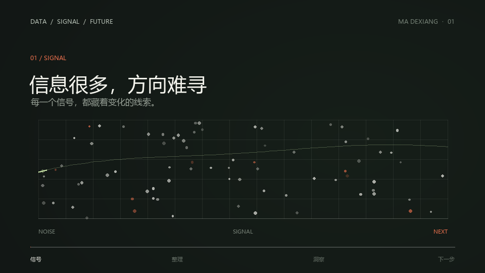

<div align="center">

# 马德祥 · 数据科学个人主页

一个以数据洞察为主题的个人作品集网站，介绍我的学习背景、关注方向与创意实践。

[访问在线主页](https://mdx-777.github.io/-/) · [查看 GitHub 仓库](https://github.com/mdx-777/-)

</div>

## 项目介绍

这个项目是我的个人求职主页，面向希望了解我的招聘者、合作伙伴和访客。页面围绕“让数据帮助人们理解问题、发现趋势”展开，展示个人简介、专业方向和项目实践。

## 页面内容

- **个人介绍**：数据科学与大数据技术专业背景及求职方向。
- **项目实践**：展示《数据，看见下一步》创意案例、视觉方向与 15 秒分镜。
- **专业方向**：数据分析、数据建模、大数据处理和可视化表达。
- **联系方式**：提供邮箱联系入口和一键复制功能。

## 交互体验

- 适配桌面与移动屏幕，移动端提供折叠导航。
- 点击播放按钮后加载项目动图，并同步高亮对应分镜。
- 页面滚动时显示内容，并提示当前所在的主要区块。
- 支持复制联系邮箱，并为辅助技术提供状态提示。
- 尊重系统的减少动态效果偏好。

## 项目预览



[下载 15 秒动效](data-next-step.gif)

## 本地预览

项目使用原生 HTML、CSS 和 JavaScript，无需安装依赖。可以直接打开 `index.html`，也可以在项目目录启动本地静态服务器：

```bash
python -m http.server 8000
```

然后访问 <http://localhost:8000>。

## 发布方式

网站通过 GitHub Pages 发布。向 `main` 分支推送更新后，GitHub Actions 会自动构建并部署静态文件。部署工作流位于 `.github/workflows/deploy.yml`。

- 在线地址：<https://mdx-777.github.io/->
- 部署状态：在 GitHub 仓库的 **Actions** 标签页查看。

## 文件结构

```text
.
├── .github/workflows/deploy.yml  # GitHub Pages 自动部署
├── data-next-step.gif            # 项目动效
├── data-next-step.png            # 项目静态预览
├── index.html                    # 页面内容
├── script.js                     # 页面交互
├── style.css                     # 页面样式
└── README.md                     # 项目说明
```
